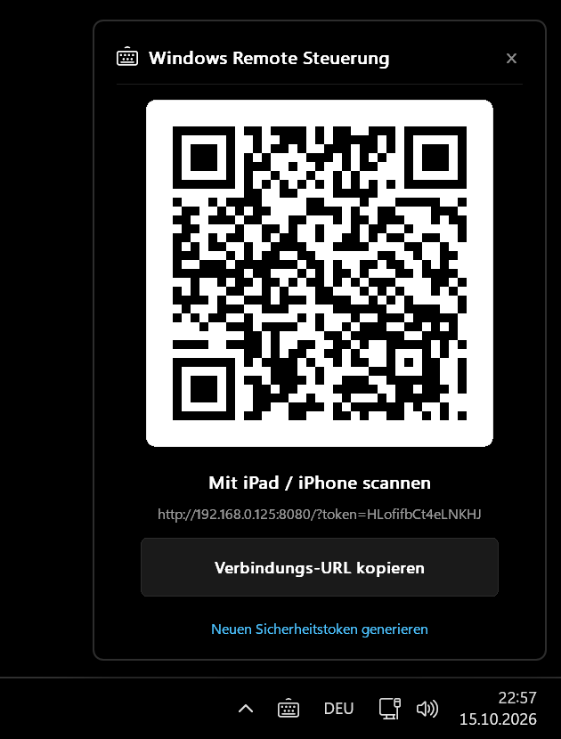

# ⌨️ Windows Remote Keyboard & Trackpad

[](https://opensource.org/licenses/MIT)
[](https://www.rust-lang.org/)
[](https://www.microsoft.com/windows)
[](#performance--ressourcen)

Ein ultra-leichtgewichtiger, ressourcenschonender Rust-Webserver zur nahtlosen Fernsteuerung von Windows-PCs über das iPad oder iPhone im lokalen Netzwerk. Bietet ein responsives Touch-Trackpad und eine deutsche QWERTZ-Tastatur direkt im mobilen Browser – ganz ohne App-Store-Download auf dem Mobilgerät.
<p align="center">
  
</p>

---

## ✨ Features

- **📱 Touch-Trackpad & Gesten**:
  - **Mauszeiger bewegen**: Flüssige Cursorsteuerung mit geringer Latenz über WebSockets.
  - **Klicken**: Tippen mit einem Finger (Linksklick), Tippen mit zwei Fingern (Rechtsklick).
  - **Zwei-Finger-Scrollen**: Weiches vertikales Scrollen (standardmäßig mit natürlicher / invertierter Windows-Richtung).
  - **Doppeltippen & Halten (Tap-to-Drag)**: Fenster greifen, Text markieren oder Drag & Drop ohne separate Tasten.
- **⌨️ Deutsche QWERTZ-Tastatur**:
  - Vollständiges deutsches Tastaturlayout inklusive Umlauten (`ä`, `ö`, `ü`, `ß`).
  - Funktionstasten (`Esc`, `Tab`, Pfeiltasten, `Enter`, `Backspace`, `Ctrl`, `Alt`, `Win`).
  - Dedizierte Medientasten: **Vorheriger Titel**, **Wiedergabe / Pause**, **Nächster Titel** sowie Lautstärkeregelung.
- **🖤 Reines OLED-Schwarz (`#000000`)**:
  - Speziell optimiert für moderne OLED-Displays auf iPhone und iPad Pro zur maximalen Akku- und Augenschonung im Dunkeln.
- **🪟 Native Windows System-Tray Integration**:
  - Unauffälliges Icon im Windows-Infobereich (Tray) neben der Uhr.
  - Kontextmenü: QR-Code anzeigen, URL kopieren, Token erneuern, Autostart umschalten, Beenden.
  - **Natives GDI QR-Code-Fenster**: Schnell mit der iPad-/iPhone-Kamera scannen und sofort verbinden.
- **🚀 1-Klick Installer & Deinstaller**:
  - Doppelklickbare `install.bat` und `uninstall.bat` – keine Admin-Rechte erforderlich!

---

## ⚡ Performance & Ressourcen

Im Gegensatz zu Lösungen auf Basis von Electron, Tauri oder Node.js setzt dieses Projekt auf maximale Effizienz:

| Metrik | Remote Keyboard | Typische Electron-App |
| :--- | :--- | :--- |
| **Arbeitsspeicher (RAM)** | **~8 – 11 MB** | ~150 – 300 MB |
| **Thread-Anzahl** | **2 Threads** (Win32 GUI + Single-Thread Tokio) | 20 – 40 Threads |
| **Binärgröße** | **~1,3 MB** (Standalone `.exe`) | > 100 MB |
| **Abhängigkeiten** | **0** (Reine Windows API via Win32 GDI & Sockets) | Chromium, Node.js, WebViews |

---

## 📥 Installation

### 1. Schnell-Installation (Empfohlen)
1. Repository klonen oder als ZIP herunterladen.
2. Doppelklick auf **`install.bat`**.
   * Die Anwendung wird nach `%LOCALAPPDATA%\Programs\RemoteKeyboard` installiert.
   * Startmenü-Verknüpfung und Windows-Autostart werden automatisch eingerichtet.
   * Es werden **keine Administrator-Rechte** benötigt.
3. Das Tray-Icon erscheint sofort unten rechts neben der Windows-Uhr.

### 2. Deinstallation
* Doppelklick auf **`uninstall.bat`** entfernt die App, den Autostart und die Startmenü-Einträge restlos.

---

## 🛠️ Aus dem Quellcode bauen

Voraussetzungen:
- [Rust & Cargo](https://rustup.rs/) (MSVC oder GNU Toolchain)

```powershell
# Repository klonen
git clone https://github.com/xX-alex1337-Xx/remote-keyboard.git
cd remote-keyboard

# Release-Binaries kompilieren
cargo build --release

# Tray-Version starten
.\target\release\remote-keyboard-tray.exe

# Oder CLI-Version mit ASCII-QR-Code im Terminal starten
.\target\release\remote-keyboard.exe
```

---

## 📱 Verbindung herstellen (iPad / iPhone)

1. Stelle sicher, dass PC und iPad/iPhone mit demselben **WLAN** verbunden sind.
2. Klicke mit der rechten Maustaste auf das Tray-Icon in Windows und wähle **"QR-Code anzeigen"**.
3. Öffne die **Kamera-App** auf dem iPad/iPhone und tippe auf den erkannten gelben Link.
4. **Tipp für Vollbild:** Tippe in Safari unten auf das **Teilen-Symbol** und wähle **"Zum Home-Bildschirm"**. Dadurch öffnet sich die Fernsteuerung wie eine native App ohne störende Browserleisten.

---

## 🏗️ Architektur

```
┌────────────────────────────────────────────────────────┐
│                   Windows System                       │
│  ┌─────────────────────────┐  ┌─────────────────────┐  │
│  │    Win32 System Tray    │  │   Win32 GDI Window  │  │
│  │  (Shell_NotifyIconW)    │  │   (QR-Code Dialog)  │  │
│  └────────────┬────────────┘  └──────────┬──────────┘  │
│               │                          │             │
│               ▼                          ▼             │
│  ┌──────────────────────────────────────────────────┐  │
│  │   Single-Thread Tokio Runtime & Axum Webserver   │  │
│  │   - Port 8080 (Statische Assets & WebSocket)     │  │
│  │   - Token-basierte Authentifizierung             │  │
│  │   - Win32 SendInput Maus- & Tastatur-Emulation   │  │
│  └────────────────────────▲─────────────────────────┘  │
└───────────────────────────┼────────────────────────────┘
                            │ WebSocket (JSON)
                            ▼
              ┌───────────────────────────┐
              │  iPad / iPhone (Safari)   │
              │  - OLED Black Web Client  │
              │  - Touchpad & Gesten      │
              │  - QWERTZ On-Screen Keys  │
              └───────────────────────────┘
```

---

## 📄 Lizenz

Dieses Projekt ist unter der **[MIT-Lizenz](LICENSE)** lizenziert – siehe die [LICENSE](LICENSE) Datei für Details.
